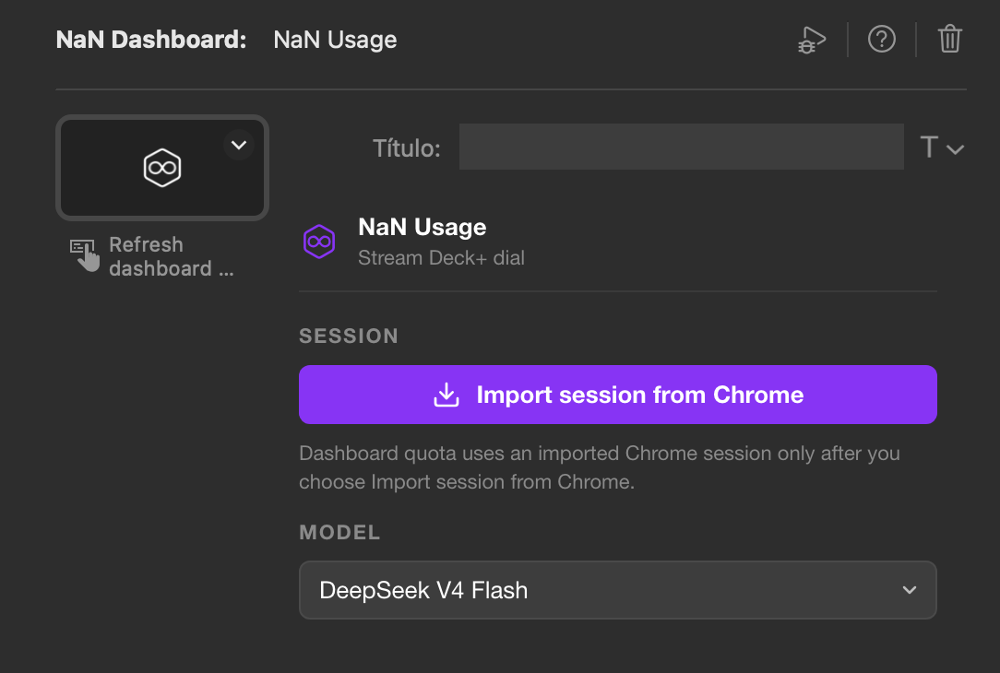
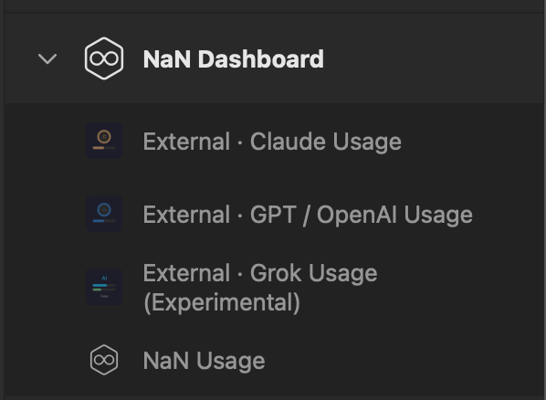
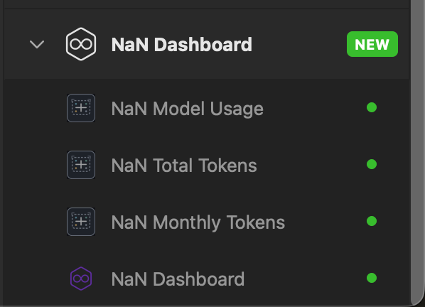

# NaN Dashboard for Stream Deck and Stream Deck+

See your NaN account's usage limits and model usage on Stream Deck and Stream Deck+. Keypad buttons work on both devices; dials require Stream Deck+. Optional integrations also show usage from Claude Code, Codex, and experimental Grok.

## Overview

<p align="center">
  
</p>
<p align="center"><em>NaN Dashboard on a Stream Deck+. Usage shown is an example and varies by account.</em></p>
<p align="center">
  More gallery views: <a href="docs/gallery/nan-hardware-desk.png">on the desk</a> &middot; <a href="docs/gallery/nan-dashboard-overview.png">app overview</a> &middot; <a href="docs/gallery/nan-usage-detail.png">usage detail</a> &middot; <a href="docs/gallery/nan-setup.png">setup</a>
</p>

## Primary Features

- **NaN usage and quota:** save your personal NaN API key from NaN Usage, NaN Model Usage, NaN Total Tokens, or NaN Monthly Tokens, then view quota, reset windows, month-to-date and all-time tokens.
- **NaN actions:** use a keypad launcher, per-model usage, all-time tokens, or month-to-date tokens without exposing your API key in settings.
- **External CLI dials:** optionally view local Claude Code, Codex, and experimental Grok Build usage through their installed, signed-in CLIs.

## Install on Your Mac

**You do not need to download the source code, install Node.js or pnpm, or use Terminal.** Download the installer, confirm installation in Stream Deck, then connect your NaN session as described below.

### Before you start

- A Mac running **macOS 13 or later**. Windows and Linux are not supported.
- The **Elgato Stream Deck app, version 7.1 or later**, installed on your Mac.
- A Stream Deck device with a free action position. **NaN Usage** requires Stream Deck+, while **NaN Model Usage**, **NaN Total Tokens**, and **NaN Monthly Tokens** can save your API key from a regular keypad key on supported Stream Deck devices.
- A **NaN API key** from your NaN account.

### 1. Download the installer

[**Download the latest macOS installer**](https://github.com/refactor-ia/streamdeck-nan/releases/latest/download/com.refactor-ia.nan.streamDeckPlugin)

The file is named **`com.refactor-ia.nan.streamDeckPlugin`**.

Alternatively, open the [latest release](https://github.com/refactor-ia/streamdeck-nan/releases/latest), expand **Assets**, and select that file. Do **not** download **Source code (zip)** or **Source code (tar.gz)** to install the plugin. `SHA256SUMS` is an optional download for verifying file integrity, not an installer.

### 2. Install it in Stream Deck

1. Open the downloaded `com.refactor-ia.nan.streamDeckPlugin` file, usually in your **Downloads** folder.
2. Stream Deck should open. Confirm its installation or update prompt.
3. Look for the **NaN** actions in the action list in Stream Deck.

The plugin is installed, but it still needs your NaN API key before it can display usage or list models.

> **macOS security notice:** this plugin is distributed without Apple signing or notarization. If macOS blocks installation, stop and [report the exact message](https://github.com/refactor-ia/streamdeck-nan/issues). Do not disable system security protections. Opening the download alone does not mean installation has completed: confirm the Stream Deck prompt.

### 3. Connect your NaN account

1. Copy your personal API key from your NaN account.
2. In the **Stream Deck app**, drag **NaN Usage**, **NaN Model Usage**, **NaN Total Tokens**, or **NaN Monthly Tokens** onto a compatible position.
3. Select that action in the app. In its configuration panel, paste your NaN API key and click **Save API key**.
4. Wait for usage data to appear. Press a keypad action for a fresh read. On the NaN Usage dial, tap the screen to toggle between the pace view and a 30-day usage history chart of the selected model (hold to refresh, rotate to change model).

<p align="center">
  
</p>
<p align="center"><em>The configuration panel stores your key only when you click Save API key.</em></p>

Your API key is stored only in the macOS Keychain, never in Stream Deck settings, and the field is cleared once it is saved. Use **Remove key** to delete it. The panel disables its buttons while it waits, then shows a safe success or retry message. If it is still waiting after fifteen seconds, the panel lets you retry.

<p align="center">
  
</p>
<p align="center"><em>NaN dial actions are available on Stream Deck+.</em></p>

### 4. Add a model button

1. Drag **NaN Model Usage** onto a regular key position in the Stream Deck app.
2. Select the new key and click **Refresh models** in its configuration panel.
3. Choose a model from the **Model** dropdown. The list comes from your NaN account, so save your API key first.
4. Pick a **Key style**: **Ring** (default, circular progress), **Bar** (large percentage with a thin bar), or **Dual rows** (labelled window row with its own bar). Colors turn amber at 75% and red at 90%.
5. Press the physical key to refresh its usage.

You can also add **NaN Total Tokens** or **NaN Monthly Tokens** to regular keys. **NaN Dashboard** only opens the dashboard in your browser; it does not use your API key or load usage data.

<p align="center">
  
</p>
<p align="center"><em>NaN keypad actions work on both Stream Deck and Stream Deck+.</em></p>

### Updating an existing installation

Download and open the latest installer, then confirm the update in Stream Deck. Updating from **v1.0.4 to v1.0.5** keeps the same action identifiers; you do not need to recreate those buttons.

Action identifiers are stable by contract. The NaN Usage dial keeps its historical `com.refactor-ia.nan.nan-demo` UUID so existing configured buttons keep working after the demo-to-usage migration; contract tests pin it, so it must not be renamed.

If you are upgrading from **v1.0.3 or earlier**, add the new actions again: v1.0.4 changed the plugin identity to Refactor IA. Old button placements are not migrated.

### If something does not work

- **The model list is empty:** first save your API key from the configuration panel of **NaN Usage**, **NaN Model Usage**, **NaN Total Tokens**, or **NaN Monthly Tokens**. If the key is already saved, click **Refresh models** on the model button instead of saving it again.
- **Stream Deck says the plugin is unstable:** make sure you installed **v1.0.5 or later**. Earlier standalone packages omitted a required runtime dependency; v1.0.5 fixes that startup problem.
- **It still does not work:** [open an issue](https://github.com/refactor-ia/streamdeck-nan/issues) with your plugin, macOS, and Stream Deck app versions, the action you selected, and any visible error message. Never include your API key, passwords, or private account data.

### Status recovery

**Dial recovery vocabulary** — **NaN Usage** on Stream Deck+ is the dial; keypad actions do not expose its full status vocabulary.

| Where and message | What to do |
| --- | --- |
| NaN Usage dial — **ADD API KEY** | Select **NaN Usage** on a dial or one of the three supported data-display keypad actions, paste your key, and click **Save API key** in its configuration panel. |
| NaN Usage dial — **KEY REJECTED** | NaN rejected the saved key. Save a current key from your NaN account. |
| NaN Usage dial — **KEYCHAIN UNAVAILABLE** | Allow the applicable macOS Keychain permission when prompted, then retry. Do not disable macOS security to work around it. |
| NaN Usage dial — **DASHBOARD UNAVAILABLE** | Refresh later. A temporary NaN failure or rate limit can be retried. |
| NaN Usage dial — **NO QUOTA** | The quota service returned nothing usable. Usage keys can still work; the quota view hides itself without raising an error. |
| NaN Total Tokens or NaN Monthly Tokens key — **METRICS ERROR** | Refresh later. Quota data can still be valid when usage totals are unavailable. |
| NaN Model Usage key — combined **NOT RETURNED** / **NO DATA** display | Click **Refresh models**, then select a model returned by the list. |
| Keypad action — **NO DATA** or **DASHBOARD OFFLINE** | These messages can combine several underlying conditions and do not uniquely diagnose the problem. Use the relevant recovery step above or report the visible message. |

**Configuration panel feedback**

| Visible message | Meaning and next step |
| --- | --- |
| Saving API key. Please wait. | The request is pending. |
| API key saved. Usage will refresh shortly. | The key was stored in the Keychain. |
| API key removed. | The key was deleted from the Keychain. |
| That does not look like a valid API key. | Paste the key again without spaces or quotes. |
| The key could not be saved. Try again. | Retry after checking Keychain access. |
| Still waiting for the plugin. You can retry when ready. | The inspector watchdog has elapsed. |
| Unable to contact the plugin. Reopen this action and try again. | Reopen this action, then try again. |
| Connection closed. Reopen this action to try again. | Reopen this action, then try again. |

When reporting an issue, include the plugin and Stream Deck versions, the action, and the visible message. Do not include your API key, passwords, account data, or raw diagnostics.

## External Integrations and Requirements

- **Claude Usage** requires Claude Code installed and signed in at `$HOME/.local/bin/claude`, `/opt/homebrew/bin/claude`, `/usr/local/bin/claude`, or `/usr/bin/claude`. It runs the official Claude CLI `/usage` command with tools disabled, then shows its session and weekly usage windows. The command must report zero turns, API duration, cost, and token usage.
- **GPT / OpenAI Usage** requires Codex CLI installed, signed in, and available as `codex` to Stream Deck. It starts one local `codex app-server`, reuses the Codex CLI session, and shows the weekly usage window returned by Codex.
- **Grok Usage (EXPERIMENTAL)** requires the optional Grok Build CLI installed and signed in. It starts the authenticated local Grok Build CLI over ACP stdio and requests only its `x.ai/billing` extension. It does not read credential files or API keys, send prompts, or invoke inference.

Touching an external encoder refreshes its data. Pressing a Claude or Codex encoder opens the corresponding provider page; Grok refreshes on touch.

## Development

Development requires Node.js 24 and pnpm 11.13.0.

Install dependencies:

```sh
pnpm install --frozen-lockfile
```

Validate TypeScript and the Stream Deck manifest:

```sh
pnpm check
```

Run the full test suite:

```sh
pnpm test:workspace
```

Build the plugin bundle:

```sh
pnpm build
```

The packaging script invokes the repository-local installed Stream Deck CLI entry
(`node_modules/@elgato/cli/bin/streamdeck.mjs`) directly; it never runs pnpm,
npm, or npx. A later authorized disposable isolated copy must expose its complete
installed `node_modules` tree at that same repository-relative path (for example,
through a read-only mount or link); the script does not install or download dependencies.

Watch source files and restart the plugin after each build:

```sh
pnpm watch
```

## Security and Privacy

The plugin reuses existing local sessions; it does not provide a login flow or
store credentials in Stream Deck settings. Claude authentication remains inside
the installed Claude CLI. The plugin runs only its built-in `/usage` command
without tools or model inference and accepts only bounded JSON with affirmative
zero-inference telemetry and the two expected usage lines. It does not read
Claude credentials or call a private usage endpoint. Claude discovery uses only
the four absolute launcher paths listed under Requirements, resolves symlinks,
and checks target identity, ownership, permissions, and parent directories
again immediately before execution. Codex and Grok use the same trusted
absolute-candidate, symlink-resolution, and pre-spawn identity-validation
controls. The final validated-path-to-spawn interval is a same-user filesystem
residual shared by these CLI launches; it is not an atomic execution guarantee.
Codex authentication remains inside the local Codex CLI and its app server.
Experimental Grok authentication also remains inside the local Grok Build CLI;
the plugin sends only ACP initialization and billing requests. The NaN API key is
stored only in the macOS Keychain, never in Stream Deck settings. The plugin sends it
only as a bearer header to two fixed NaN origins, refuses redirects, and does not
expose the key, provider URLs, or Keychain secrets in settings, feedback, or logs.

Tokens, authorization headers, raw provider payloads, and CLI diagnostics are
not written to logs, settings, action feedback, or the property inspector. Usage
requests go directly through the official provider sessions, with no third-party
relay.

### Reporting Security Issues

If you discover a security vulnerability, please report it privately. See
[SECURITY.md](SECURITY.md) for details. Our data-handling practices are
described in [PRIVACY.md](PRIVACY.md).

## Advanced Architecture and Status

The `com.refactor-ia.nan` migration recreates all eight Stream Deck buttons, so users add the new actions again after installing version 1.0.4. 

The generated, tracked bundle at `com.refactor-ia.nan.sdPlugin/bin/plugin.js` keeps the plugin directory self-contained.

### NaN Data Behavior Details

The NaN Usage dial and the NaN Model Usage, NaN Total Tokens, and NaN Monthly Tokens keys read data with your saved NaN API key. The plugin never reads the key during appearance, refresh, rotation, settings, or wake handling beyond the shared usage request. Month-to-date per-model tokens and all-time totals come from one `GET /v1/usage` request per refresh (30 requests per minute allowed; a `429` is honored through `Retry-After`). Quota (`used / cap`, raw percentage, reset or rolling window) comes from the NaN dashboard quota service, which is not part of the published API: it is requested from a fixed origin with strict schema validation, and any failure hides only the quota while usage keeps working. A saved `legacy` source is migrated to `dashboard` once when its dial appears; all other settings and model IDs are preserved verbatim. Touching the dial refreshes its data; rotating it selects an API-returned capped model. **NaN Model Usage** selects one API-returned capped or uncapped model per key and refreshes the shared snapshot when pressed. A rejected key returns to onboarding without showing a prior account's data.

### NaN Validation Status

The API key flow is covered by focused mocked tests and was validated manually on a real Stream Deck with a real API key, including the quota service accepting the key as a bearer credential. If the quota service ever rejects the key, only the quota view is hidden; usage keeps working. A release still requires the project's release-process validation. This checkout does not claim production readiness, perform signing, restart Stream Deck, or deploy the plugin.

### Platform Support

The current manifest supports macOS only. Encoder actions target Stream Deck+;
NaN Model Usage, NaN Total Tokens, NaN Monthly Tokens, and NaN Dashboard are also available as standard keypad actions.

## Contributing

Contributions are welcome! Please read [CONTRIBUTING.md](CONTRIBUTING.md) for guidelines.

## License

This project is licensed under the MIT License. See [LICENSE](LICENSE) for details.
---

<a href="https://github.com/Gentleman-Programming/gentle-ai">
  
</a>

<a href="https://nan.builders/?ref=built-with-nan">
  <picture>
    <source media="(prefers-color-scheme: light)" srcset="https://nan.builders/badge/built-with-nan-light.svg">
    
  </picture>
</a>
